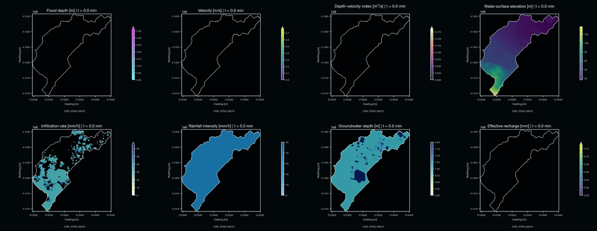

<p align="center">
  <a href="https://marcusnobrega-eng.github.io/HydroPol2D-docs/">
    
  </a>
</p>

<p align="center">
  <a href="https://github.com/marcusnobrega-eng/HydroPol2D/stargazers"></a>
  <a href="https://github.com/marcusnobrega-eng/HydroPol2D/forks"></a>
  <a href="https://github.com/marcusnobrega-eng/HydroPol2D/watchers"></a>
</p>

<p align="center">
  <a href="https://github.com/marcusnobrega-eng/HydroPol2D/tags"></a>
  <a href="https://github.com/marcusnobrega-eng/HydroPol2D/commits/main"></a>
  <a href="https://github.com/marcusnobrega-eng/HydroPol2D/commits/main"></a>
  <a href="https://github.com/marcusnobrega-eng/HydroPol2D/issues"></a>
  <a href="LICENSE"></a>
  
  <a href="https://marcusnobrega-eng.github.io/HydroPol2D-docs/"></a>
  <a href="https://github.com/marcusnobrega-eng/HydroPol2D-Studio-releases/releases"></a>
  <a href="https://doi.org/10.1016/j.jhydrol.2023.129982"></a>
</p>

<p align="center">
  <a href="https://marcusnobrega-eng.github.io/HydroPol2D-docs/"><b>Documentation</b></a> ·
  <a href="#quick-start"><b>Quick start</b></a> ·
  <a href="#examples-you-can-run"><b>Examples</b></a> ·
  <a href="#gallery"><b>Gallery</b></a> ·
  <a href="https://github.com/marcusnobrega-eng/HydroPol2D-Studio-releases/releases"><b>Studio</b></a> ·
  <a href="#cite"><b>Cite</b></a>
</p>

HydroPol2D is a distributed 2D hydrologic-hydrodynamic and water-quality model. It follows rain
across a landscape, cell by cell: what the canopy and snowpack hold, what infiltrates and
recharges the aquifer, and where the runoff flows, how deep it gets and what pollutants it
carries. It runs in MATLAB on a raster grid or a mesh, on the CPU or an NVIDIA GPU, for urban,
peri-urban and rural catchments, gauged or data-scarce. The same physics runs in
[HydroPol2D Studio](https://github.com/marcusnobrega-eng/HydroPol2D-Studio-releases/releases),
a desktop app with a graphical interface.

<p align="center">
  <a href="https://marcusnobrega-eng.github.io/profile/files/stanford-campus-coupled-states.mp4">
    
  </a>
  <br />
  <sub>Stanford campus, CA, 10 m coupled simulation: flood depth, velocity, depth-velocity index and water-surface elevation (top); infiltration rate, rainfall, groundwater depth and effective recharge (bottom). Click for the full-resolution video.</sub>
</p>

## What it does

<p align="center">
  
</p>

| Area | What HydroPol2D computes |
|---|---|
| **Surface flow** | Local-inertial routing (default); kinematic, diffusive, full-momentum and cellular-automata solvers; D8 local inertial; Neal (2012) subgrid channels |
| **Hydrology** | Interception, Penman-Monteith evapotranspiration, snow accumulation and melt, Darcy-based infiltration through three soil layers |
| **Subsurface** | Water table with 2D Boussinesq lateral flow, an optional soil-over-regolith column, a deep aquifer and river-aquifer exchange |
| **Infrastructure** | Reservoirs and control structures, dam break, urban drainage networks, detention ponds and green infrastructure |
| **Water quality and risk** | Pollutant build-up and wash-off; human instability as a risk index or as slide, topple and drowning classes |
| **Grids and computing** | Raster grid or prepared Voronoi and quadtree meshes; CPU or GPU; Courant-based adaptive time step with a mass-balance check |
| **Outputs** | GeoTIFF maps, MP4 animations, hydrographs and water balances as CSV, figures as PDF and PNG |

## Quick start

```bash
git clone https://github.com/marcusnobrega-eng/HydroPol2D.git
```

Open MATLAB in the `HydroPol2D` folder and run an example:

```matlab
run('Examples/VTilted_Excel/run_excel.m')   % synthetic V-tilted catchment, about 3 min
run('Examples/Stanford/run_excel.m')        % San Francisquito Creek, CA, about 14 min
```

**Requirements:** MATLAB R2020a or newer with the Mapping and Image Processing Toolboxes. GPU
runs need the Parallel Computing Toolbox and an NVIDIA GPU; DEM smoothing needs the
Optimization Toolbox.

**Your own case:** a case is one Excel workbook. Copy
[`Input_Data_Sheets/HydroPol2D_Inputs.xlsx`](Input_Data_Sheets/HydroPol2D_Inputs.xlsx), fill its
tabs and run `HydroPol2D_V115.m`. Every tab and setting is described, with a picture of each tab,
in [Case Workbook Settings](https://marcusnobrega-eng.github.io/HydroPol2D-docs/manual/configuration/general_data)
and [Run from Excel](https://marcusnobrega-eng.github.io/HydroPol2D-docs/manual/getting-started/excel-workflow).
Scripted studies use [`Config/input_data_bypass_script.m`](Config/input_data_bypass_script.m)
instead.

## Examples you can run

| Example | Run in MATLAB | What it shows | Time | Expected results |
|---|---|---|---|---|
| [V-tilted catchment](Examples/VTilted_Excel/README.md) (synthetic) | `run('Examples/VTilted_Excel/run_excel.m')` | 10.8 mm/h for 90 min, 180 min simulated; regular grid or a prepared Voronoi mesh | ~3 min | rain 16.20 mm, peak outflow 1.525 m³/s, runoff coefficient 0.94, max depth 0.15 m |
| [San Francisquito Creek](Examples/Stanford/README.md), CA (30 m) | `run('Examples/Stanford/run_excel.m')` | 100 mm/h for 1 h on a 157 km² catchment, 180 min simulated | ~14 min | rain 99.97 mm, peak outflow 402.8 m³/s, runoff coefficient 0.16, max depth 5.87 m |
| [One check per process](Validation/README.md) | each case's run script | about 80 small synthetic cases, each with a pass/fail rule | 1-10 min each | [Validation_Cases.csv](Validation/Validation_Cases.csv) |

Results go to each example's `Outputs/` folder. The
[24 h version of the Stanford case](https://marcusnobrega-eng.github.io/HydroPol2D-docs/manual/Examples/RainfallRunoff)
is on the website, with its maps and video.

## Gallery

Results from studies. Their inputs are not in this repository.

<table>
  <tr>
    <td align="center" width="50%">
      <br />
      <sub>Rain on the grid: a 50-year storm over an urban catchment with drainage, São Paulo, Brazil</sub>
    </td>
    <td align="center" width="50%">
      <br />
      <sub>Total dam-break collapse over a city in Pernambuco, Brazil</sub>
    </td>
  </tr>
</table>

**Rainfall-runoff event in a catchment near Palo Alto, CA**

https://github.com/user-attachments/assets/739e39eb-18e8-4ec3-bee6-a7a647793774

**22-day continuous simulation with spatially varied MSWEP rainfall, Pune, India**

https://github.com/user-attachments/assets/3ad69bb3-3e24-4df3-b5ff-584aafcc6296

## How a run works

<p align="center">
  
</p>

Maps (DEM, land use and soil, plus optional rasters), class tables, forcing and settings make one
case. HydroPol2D-MATLAB runs the case workbook; HydroPol2D Studio runs the same physics from its
own model file. For cases prepared by the HydroPol2D Case Builder, see the shared
[model-building workflow](https://marcusnobrega-eng.github.io/HydroPol2D-docs/manual/getting-started/model-building-workflow).

## Repository layout

| Path | Contents |
|---|---|
| [`HydroPol2D_V115.m`](HydroPol2D_V115.m) | Main script; reads the case workbook |
| [`HydroPol2D_Functions/`](HydroPol2D_Functions) | Model code |
| [`Input_Data_Sheets/`](Input_Data_Sheets) | Case workbook template |
| [`Config/`](Config) | Script configuration for automated studies |
| [`Examples/`](Examples) | Runnable examples |
| [`Validation/`](Validation/README.md) | Process checks with pass/fail rules |
| [`Applications/`](Applications/README.md) | SLURM template and dam-case runners |
| [`tools/`](tools) | Workbook builder (converts older `General_Data.xlsx` cases) and utilities |
| [`third_party/`](third_party/NOTICE.md) | Bundled TopoToolbox terrain runtime |

## Documentation

The [HydroPol2D website](https://marcusnobrega-eng.github.io/HydroPol2D-docs/) (English,
Portuguese and Spanish) has the full manual:
[getting started](https://marcusnobrega-eng.github.io/HydroPol2D-docs/manual/getting-started/overview),
[inputs](https://marcusnobrega-eng.github.io/HydroPol2D-docs/manual/inputs/overview),
[case workbook](https://marcusnobrega-eng.github.io/HydroPol2D-docs/manual/configuration/general_data),
[theory](https://marcusnobrega-eng.github.io/HydroPol2D-docs/manual/theory/overview),
[validation](https://marcusnobrega-eng.github.io/HydroPol2D-docs/manual/validation/overview) and the
[changelog](https://marcusnobrega-eng.github.io/HydroPol2D-docs/manual/validation/changelog).

## Versions

The current release candidate is **v1.19.0-rc2** ([release notes](RELEASE_NOTES_v1.19.0-rc2.md)),
coordinated with HydroPol2D-Python v0.9.0-rc2 (HydroPol2D Studio 0.9.0rc2) and HydroBathyDEM
0.4.0rc1. The stable numerical reference remains `v1.17.0` until the remaining hardware and
packaging checks pass.

## Data sources of the examples

- **San Francisquito Creek, terrain:** USGS 3D Elevation Program (3DEP), 10 m averaged to 30 m
  (`Examples/Stanford/Static/DEM.tif`) and 10 m (`Examples/Stanford/Static_10m_LiDAR`), U.S. public domain.
- **San Francisquito Creek, land use:** ESA WorldCover 2020 (v100), CC BY 4.0. © ESA WorldCover
  project 2020 / Contains modified Copernicus Sentinel data (2020) processed by ESA WorldCover
  consortium. The class codes 10 to 90 and their names in the land-use table are WorldCover's.
- **San Francisquito Creek, other maps:** uniform values set for the example (soil class 8, depth
  to bedrock 1.5 m, LAI 1, albedo 0.25, initial soil moisture 0.1104).
- **V-tilted catchment:** all inputs are generated by
  [`prepare_standard_case.m`](Examples/VTilted_Excel/prepare_standard_case.m).

## Cite

If you use HydroPol2D, please cite:

- Gomes Jr, M.N., et al., 2023. [HydroPol2D: Distributed hydrodynamic and water quality model: Challenges and opportunities in poorly-gauged catchments](https://doi.org/10.1016/j.jhydrol.2023.129982). *Journal of Hydrology*, 625, 129982.
- Gomes Jr, M.N., Castro, M.A., Castillo, L.M., Sánchez, M.H., Giacomoni, M.H., de Paiva, R.C. and Bates, P.D., 2025. [Spatio-temporal performance of 2D local inertial hydrodynamic models for urban drainage and dam-break applications](https://doi.org/10.1016/j.jhydrol.2025.134661). *Journal of Hydrology*.

<details>
<summary><b>More publications using HydroPol2D</b></summary>

- Gomes Jr, M.N., Jalihal, V., Castro, M. and Mendiondo, E.M., 2025. [Exploring the impact of rainfall temporal distribution and critical durations on flood hazard modeling](https://doi.org/10.1007/s11069-025-07186-3). *Natural Hazards*.
- Gomes Jr, M.N., et al., 2024. [Global optimization-based calibration algorithm for a 2D distributed hydrologic-hydrodynamic and water quality model](https://doi.org/10.1016/j.envsoft.2024.106128). *Environmental Modelling & Software*, 179, 106128.
- Rápalo, L.M., Gomes Jr, M.N. and Mendiondo, E.M., 2024. [Developing an open-source flood forecasting system adapted to data-scarce regions: A digital twin coupled with hydrologic-hydrodynamic simulations](https://doi.org/10.1016/j.jhydrol.2024.131929). *Journal of Hydrology*, 644, 131929.
- Rápalo, L.M., Gomes Jr, M.N. and Mendiondo, E.M., 2025. [Multiple levels of human instability due to urban overland flow within the 21st century: An urban catchment study case in Brazil](https://doi.org/10.1016/j.ijdrr.2025.105931). *International Journal of Disaster Risk Reduction*.
- Castro, M., Gomes Jr, M., Rápalo, L. and Mendiondo, E., 2025. [Performance of low-complexity hydrodynamic models for dam-break flood mapping: Trade-offs between full momentum, diffusive-wave, and local-inertial models](https://doi.org/10.22541/essoar.175242171.16927854/v1) (under review).
- Castro, M.D.A.R.A., Gomes Jr, M.N. and Mendiondo, E.M., 2025. *Probabilistic dam-break flood mapping via Monte Carlo simulations using a 2D local-inertial model* (DOI not available).
- Sanchez, M.H., Gomes Jr, M.N., Rápalo, L., Castro, M.D.A.R.A. and Mendiondo, E.M., 2026. [Assessment of urban vulnerability to floods under current and future demographic and climate scenarios](https://doi.org/10.2139/ssrn.6381670). SSRN (under review).
- Sousa, M.R.D., Mendiondo, E.M. and Gomes, M.N., 2026. [Hydrological-hydrodynamic modeling of climate-induced urban flooding of design storms using HydroPol2D: a case study in São Carlos, Brazil](https://www.scielo.br/j/rbrh/a/KFQjyK4vxHPscnyCCRrBGjH/?format=pdf&lang=en). *RBRH*.
- Sánchez, M.H., 2025. [A novel framework for flood vulnerability assessment and fuzzy-controlled reservoir optimization in data-scarce urban watersheds](https://teses.usp.br/teses/disponiveis/18/18138/tde-30072025-105642/publico/CORRIGIDO_Mateo_Hernandez_Sanchez.pdf). Master's thesis, University of São Paulo.
- Castro, M.D.A.R.A., 2024. [Métodos determinísticos e probabilísticos para a avaliação do impacto de rompimentos de barragens via modelagem hidrodinâmica](https://teses.usp.br/teses/disponiveis/18/18138/tde-21032025-085649/publico/Dissertacao_versao_corrigida.pdf). Master's thesis, University of São Paulo.
- Rápalo, L.M.C., 2024. [Open-source tools for flood risk assessment for multiple spatio-temporal scales under scenarios of change](https://teses.usp.br/teses/disponiveis/18/18138/tde-07102024-094249/publico/ThesisCastilloRapaloLuisMiguelCorrected.pdf). Doctoral dissertation, University of São Paulo.
- Gomes Jr, M.N., 2023. [Advances in open source hydroinformatics for flood modeling and disaster education](https://teses.usp.br/teses/disponiveis/18/18138/tde-18042024-142515/publico/TeseMarcusNobregaGomesJuniorVersaoCorrigidaCompressed.pdf). Doctoral dissertation, University of São Paulo.

</details>

## License

HydroPol2D is licensed under the [GNU General Public License v3.0](LICENSE). The bundled
TopoToolbox runtime is described in [`third_party/NOTICE.md`](third_party/NOTICE.md) and
[`third_party/topotoolbox_lite/UPSTREAM.md`](third_party/topotoolbox_lite/UPSTREAM.md).

## Contact

**Dr. Marcus N. Gomes Jr.**, [mngomes@stanford.edu](mailto:mngomes@stanford.edu). Questions and
bug reports are welcome as [GitHub issues](https://github.com/marcusnobrega-eng/HydroPol2D/issues).
A short course (2-hour classes with slides) is available on request at
marcusnobrega.engcivil@gmail.com.

**Acknowledgments:** University of São Paulo, São Carlos School of Engineering; University of
Texas at San Antonio, Civil and Environmental Engineering; Stanford University, Stanford Doerr
School of Sustainability, Department of Earth System Science.
